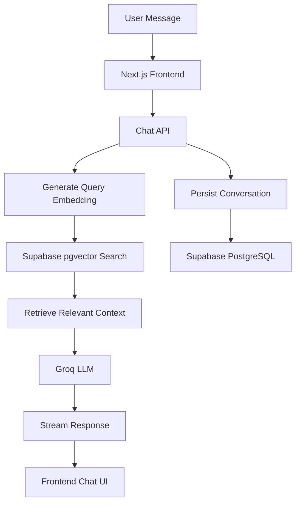

# AI Portfolio Assistant

An AI-powered portfolio chatbot that answers questions about my professional background, skills, projects, and experience using Retrieval-Augmented Generation (RAG).

The application retrieves relevant information from a structured knowledge base and uses an LLM to generate context-grounded responses. It also supports streaming replies, user authentication, and persistent conversations.

**Live Demo:** [Try the AI Portfolio Assistant](https://ai-portfolio-chatbot-65kk.vercel.app)

**Source Code:** [GitHub Repository](https://github.com/riyasingh49/ai-portfolio-chatbot)

## Features

- **RAG-based question answering:** Retrieves relevant information from a vector database before generating responses.
- **Context-grounded responses:** Designed to answer questions using information available in the portfolio knowledge base.
- **Streaming responses:** Displays generated answers incrementally.
- **Authentication:** Supports email/password authentication, Google sign-in, and password recovery.
- **Conversation management:** Allows authenticated users to create, access, and switch between conversations.
- **Guest access:** Allows visitors to try the chatbot without creating an account, subject to usage restrictions.
- **Email drafting:** Helps visitors draft professional emails using relevant portfolio information.
- **Responsive interface:** Built with Next.js, React, TypeScript, and Tailwind CSS.

## Tech Stack

| Category | Technologies |
|---|---|
| Frontend | Next.js, React, TypeScript, Tailwind CSS |
| Database | Supabase PostgreSQL |
| Vector Search | pgvector |
| Embeddings | Cloudflare Workers AI — `bge-small-en-v1.5` |
| Language Model | Groq — `openai/gpt-oss-20b` |
| Authentication | Supabase Auth |
| Deployment | Vercel |
| Version Control | Git, GitHub |

## Architecture Overview

The application uses a Retrieval-Augmented Generation pipeline to generate responses from portfolio-specific information.



### Request Flow

1. The user submits a message through the chat interface.
2. The API processes the request and prepares an embedding for semantic retrieval.
3. Supabase pgvector searches the knowledge base for relevant information.
4. Retrieved context is included in the prompt sent to the language model.
5. The model generates a response that is streamed to the frontend.
6. Conversation messages are persisted where applicable.

## Key Technical Decisions

### Retrieval-Augmented Generation

RAG allows the chatbot to retrieve relevant portfolio information at query time instead of relying entirely on information learned during model training. This makes the knowledge base easier to update independently of the language model.

### Vector Search with pgvector

Supabase PostgreSQL and pgvector store embeddings and support similarity-based retrieval. This keeps the knowledge base and application data within the same database platform.

### Hosted Embedding and LLM Services

Cloudflare Workers AI generates embeddings, while Groq provides language-model inference. Using hosted inference services avoids the need to run a large language model locally.

### Streaming Responses

The chat API streams generated text to the frontend, improving the perceived responsiveness of the conversation.

## Getting Started

### Prerequisites

- Node.js 20.9 or later
- A Supabase project with the required database schema and pgvector support
- A Groq API key
- Cloudflare account credentials with access to Workers AI

### 1. Clone the Repository

```bash
git clone https://github.com/riyasingh49/ai-portfolio-chatbot.git
cd ai-portfolio-chatbot
```

### 2. Install Dependencies

```bash
npm install
```

### 3. Configure Environment Variables

Create a `.env.local` file in the project root:

```env
NEXT_PUBLIC_SUPABASE_URL=
NEXT_PUBLIC_ANON_KEY=
SUPABASE_SERVICE_ROLE_KEY=
GROQ_API_KEY=
CLOUDFLARE_ACCOUNT_ID=
CLOUDFLARE_API_TOKEN=
```

Add the appropriate values from your service dashboards. Keep secret values private, and never commit `.env.local` or service-role credentials to GitHub.

### 4. Prepare the Knowledge Base

Configure the required database tables, vector-search function, and indexes in Supabase. Add the portfolio information to the knowledge-base source file, then run the embedding script:

```bash
npx tsx --env-file=.env.local scripts/embed-knowledge.ts
```

This step populates the vector database with embeddings for retrieval.

### 5. Start the Development Server

```bash
npm run dev
```

Open [http://localhost:3000](http://localhost:3000) in your browser.

## Project Structure

The project is organized around the chat interface, API routes, reusable components, data access, and supporting utilities.

```text
src/
├── app/          # Application pages and API routes
├── components/   # Reusable UI components
├── hooks/        # Client-side chat and state logic
├── lib/          # Shared utilities and integrations
├── db/           # Database-related code
└── actions/      # Server actions
scripts/
└── embed-knowledge.ts
```

*This is a high-level overview; individual modules may vary as the project evolves.*

## Future Improvements

- Evaluate retrieval quality using a representative set of questions.
- Improve relevance through knowledge-base refinement and retrieval tuning.
- Add automated tests for critical chat, authentication, and conversation workflows.
- Improve monitoring and error handling for external service failures.

## License

This is a personal portfolio project intended to demonstrate my development skills. Contact the repository owner before reusing substantial portions of the implementation.
